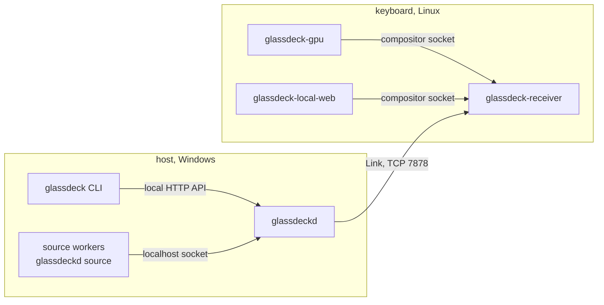

# Glassdeck

A customization stack for the Flux keyboard's 1920x1080 display. The display is driven by an RK3566 board (Mali-G52, panfrost, GLES 3). Glassdeck streams video to it from a Windows host, plays backgrounds on the keyboard itself, and runs widgets on the band above the F-row.

Pre-release. Package formats and the protocol are versioned, and a build refuses versions other than its own.

## Vocabulary

| Term | Meaning |
|---|---|
| Pipeline | Source -> Encoder -> Link -> Decoder -> Compositor |
| host | The Windows PC that runs glassdeckd and streams to the keyboard |
| keyboard | The RK3566 board, running Linux |
| stream | A named feed, such as `monitor-q27g4zd` |
| canvas | A Slang `[Canvas]` shader plus optional `keyboard.luau`, `options.luau` and `host.luau`, packed as a `.deckbg` |
| module | A widget package (`.deckmod`) with a keyboard half and an optional host half |
| options | What `options.luau` declares and the user chooses |

## Processes



- Source and Encoder run in a source worker (one process per source, because CEF starts once per process).
- glassdeckd owns the Link and runs the host halves of modules and canvases.
- glassdeck-receiver decodes (Rockchip MPP) and composites (DRM/KMS planes). With nothing streaming it starts a renderer process for the chosen background.

## Crates

| Crate | Side | What it is |
|---|---|---|
| [glassdeckd](crates/glassdeckd) | host | The host daemon. It owns the Link, runs sources and the host halves of modules and canvases, and serves the local HTTP API. |
| [glassdeck](crates/glassdeck) | host | The CLI. |
| [glassdeck-api](crates/glassdeck-api) | host | The local API's shared request and response types, with generated TypeScript types. |
| [glassdeck-capture](crates/glassdeck-capture) | host | Sources and Encoders: monitors, web pages, files, backgrounds, Wallpaper Engine scenes. |
| [glassdeck-convert](crates/glassdeck-convert) | host | Turns a video file or web page folder into a `.deckbg`. |
| [glassdeck-wallpaper-engine](crates/glassdeck-wallpaper-engine) | host | Imports Wallpaper Engine items from the local Steam workshop folder. |
| [glassdeck-slang](crates/glassdeck-slang) | host | Slang compiler bindings and `glassdeck pack` for canvases. |
| [glassdeck-luau-check](crates/glassdeck-luau-check) | host | Luau type checker bindings, for checking scripts when packing. |
| [glassdeck-proto](crates/glassdeck-proto) | both | The Link wire protocol and the keyboard's compositor socket protocol. |
| [glassdeck-package](crates/glassdeck-package) | both | The `.deckbg` and `.deckmod` container formats. |
| [glassdeck-luau](crates/glassdeck-luau) | both | Shared Luau VM core, options, profiles and resource handles. |
| [glassdeck-layout](crates/glassdeck-layout) | both | Key and widget area geometry on the 1920x1080 panel. |
| [glassdeck-gpu](crates/glassdeck-gpu) | keyboard | The canvas renderer process, and its core shared with the host preview. |
| [glassdeck-receiver](crates/glassdeck-receiver) | keyboard | Decoder, Compositor and widget host. Also builds on Windows as a preview window. |

## Build

### Host (Windows)

```sh
cargo build
```

glassdeck-capture's build script builds CEF with silo through `uv`. It needs `uv` on `PATH` and a silo checkout at `../silo` beside this repo, or `SILO` set to one.

### Native libraries

Slang and the Luau checker are loaded at run time from `target/native`. Build them once with silo:

```sh
cd native
uv run python build.py
```

The CLI looks in `GLASSDECK_NATIVE`, else beside `glassdeck.exe`. See [native/README.md](native/README.md).

### Keyboard (aarch64 Linux)

Builds run in Docker against the stock keyboard's glibc 2.36. From the repo root (Git Bash or WSL):

```sh
sh device/keyboard-build.sh --fetch-mpp root@<board>   # once: copies Rockchip MPP into target/keyboard-sysroot
sh device/keyboard-build.sh glassdeck-receiver glassdeck-gpu
```

Binaries land in `target/keyboard/`. glassdeck-local-web is C and builds on the board with meson; see [device/glassdeck-local-web/README.md](device/glassdeck-local-web/README.md).

## Test

```sh
cargo test --workspace
```

Some tests are `#[ignore]` because they need a GPU or `ffmpeg` on `PATH`. Run them with:

```sh
cargo test --workspace -- --ignored
```

## Layout

| Path | Contents |
|---|---|
| `crates/` | Rust crates, one workspace |
| `native/` | C++ wrappers over Slang and Luau's Analysis library, and their silo recipes |
| `device/` | Keyboard build scripts, `.ipk` packaging, and glassdeck-local-web |
| `canvases/` | Canvas sources. `gradient` is the built-in canvas |
| `modules/` | Example widget modules and a sample `profile.json` |
