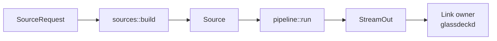

# glassdeck-capture

The Source and Encoder stages, plus the host's end of the Link. Host only, Windows only. glassdeckd runs each source in a worker process, and the CLI uses the local tools (`monitors`, `record`).



## Sources

`sources::SourceRequest { play, seconds }` is the source as data (tagged JSON). The CLI sends it to glassdeckd, and the worker builds it with `sources::build`.

| `Play` | What | Timing | Encoder |
|---|---|---|---|
| `Monitor` | Mirror a monitor (Windows.Graphics.Capture) | Live | GPU (Media Foundation) or software (openh264) |
| `Web` | Render a URL offscreen with CEF | Paced | GPU |
| `File` | An H.264 or HEVC MP4 | Paced | None, sent as it is |
| `Background` | A background `.deck`: video sent as it is, web rendered with CEF | Paced | None, or GPU for web |
| `Wallpaper` | A Wallpaper Engine item: video and web via its `.deck` (built on first use), scenes live | Paced | As above, GPU for scenes |

Canvas backgrounds can't be streamed. The keyboard draws them itself.

## Main types

- `pipeline::Source`: `Frames(Box<dyn FrameSource>)` (raw frames, encoded by the source) or `Encoded(Box<dyn EncodedSource>)` (already encoded).
- `pipeline::run(source, out)`: everything from `StreamStart` to `StreamEnd`, written to a `StreamOut`.
- `pipeline::{EncoderSettings, VideoCodec, Timing}`, `EncoderKind` (`Gpu` or `Software`).
- `pipeline::request_stop` / `stop_requested`: stop the running source.
- `link::Link`: the protocol over TCP. `connect`, `send`, `sync_clock`. It can be throttled to a simulated USB 2.0 rate.
- `clock::{ClockSample, best_sample}`: clock offset from probes.
- `monitors::{enumerate, find, select, MonitorQuery}`: pick a monitor by index or name.
- `record::run`: record a monitor to a local file.
- `helper_process_exit_code()`: call first in `main`. CEF relaunches the program for its own subprocesses.

## Platform

- Windows only: Direct3D 11, Media Foundation and Windows.Graphics.Capture. Scene sources mute Wallpaper Engine in the volume mixer while they run.
- The build script builds CEF with silo through `uv`. It needs `uv` and a silo checkout at `../silo` beside the repo, or `SILO` set. It copies the CEF runtime into `target/<profile>/`.
- Binaries that link it add `/DELAYLOAD:libcef.dll`, so only web sources need `libcef.dll`.

## Test

```sh
cargo test -p glassdeck-capture
cargo test -p glassdeck-capture -- --ignored
```

| Ignored test | Needs |
|---|---|
| `gpu::converter_produces_bt709_limited_range` | A GPU |
| `gpu::dropping_the_encoder_drains_every_submitted_frame` | A GPU |
| `gpu::scales_down_and_makes_a_keyframe_when_asked` | A GPU |
| `gpu::bench_convert` | A GPU; a benchmark, run with `--release -- --ignored --nocapture` |
| `play::a_loop_starts_one_frame_after_the_last_frame` | `ffmpeg` on `PATH` |
