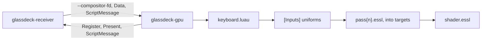

# glassdeck-gpu

The keyboard's GPU renderer. A binary that runs on the keyboard, plus a library shared with the receiver's Windows preview and the desktop app's canvas preview.

On the keyboard, glassdeck-receiver starts it whenever a canvas or an image owns the screen: the built-in gradient (shown when nothing else does), a canvas `.deck` or an image `.deck`. It draws into GBM scanout buffers and presents them over the compositor socket.



## Library

| Item | Role |
|---|---|
| `program::CanvasProgram` | A canvas's GLSL ES shaders and its script. `new(gl, files, print)`; `deliver_options`, `deliver_message`, `take_messages` for `bridge`; `inputs()`; `draw(gl, framebuffer, size, seconds)` returns the frame's cost, or `None` when nothing was drawn |
| `program::render_size(scale)` | Render size for a canvas's scale |
| `script::CanvasScript` | `keyboard.luau`: `load(source, messages, inputs, print)`, `deliver_options` (to `bridge.on.options`), `deliver_message`, `take_messages`, `frame`, `take_changes`, `unwritten` (inputs the script never set) |
| `script::InputValue` | A written input value |
| `image::Picture`, `image::ImageProgram` | An image background: decoded once, drawn once |
| `offscreen::Offscreen` | Windows only: a hidden WGL context (GL 4.3 core, which takes GLSL ES 3.00) and a framebuffer to read back, fragment row 0 first |
| `BUILT_IN`, `built_in()` | `canvases/gradient`, packed as `builtin/gradient.deck` (id `core.glassdeck.gradient`), and the same opened as `CanvasFiles` |

Each pass draws into its target, then the canvas draws the screen, reading the targets as textures. A `[Feedback]` target swaps between two textures, so a pass reads its last frame. Only inputs written since the last draw are uploaded, and a frame where nothing changed and nothing reads the clock or keeps a history isn't drawn.

## Binary

```sh
glassdeck-gpu --compositor-fd <fd> [--canvas bg.deck | --image bg.deck]   # keyboard, as the receiver starts it
glassdeck-gpu --bench <frames> [--canvas bg.deck]                        # keyboard, no receiver: frame costs
glassdeck-gpu --snapshot out.rgba [--canvas bg.deck | --image bg.deck]   # one frame at 10 s as raw RGBA
```

On Windows only `--snapshot` works, through the same shaders and script, so host and keyboard output compare directly.

## Platform

- Linux: GBM and EGL, with no window. `libgbm` and `libEGL` load at run time, so the cross-build needs neither. Uses DRM and glassdeck-proto's compositor protocol.
- Windows: WGL through `offscreen`.
- Build for the keyboard with `sh device/keyboard-build.sh glassdeck-gpu`.

## Test

`the_built_in_gradient_matches_its_sources` fails when `canvases/gradient` or `glassdeck.slang` changed without repacking. Repack with:

```sh
glassdeck pack canvases/gradient --out crates/glassdeck-gpu/builtin/gradient.deck
```
