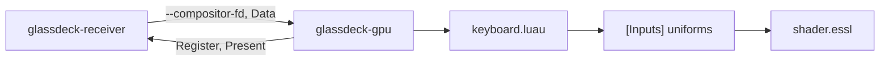

# glassdeck-gpu

The canvas renderer. A binary that runs on the keyboard, plus a library shared with the receiver's Windows preview.

On the keyboard, glassdeck-receiver starts it whenever a canvas owns the screen: the built-in gradient (shown when nothing else does) or a canvas `.deck`. It draws into GBM scanout buffers and presents them over the compositor socket.



## Library

| Item | Role |
|---|---|
| `program::CanvasProgram` | A canvas's GLSL ES shader and its script. `new(gl, files)`, `deliver(payload)`, `draw(gl, framebuffer, size, seconds)` |
| `program::render_size(scale)` | Render size for a canvas's scale |
| `script::CanvasScript` | `keyboard.luau`: `load`, `deliver` (host data to `canvas.on_data`), `frame`, `take_changes` |
| `script::InputValue` | A written input value |
| `offscreen::Offscreen` | Windows only: a hidden WGL context (GL 4.3 core, which takes GLSL ES 3.00) and a framebuffer to read back |
| `BUILT_IN` | `canvases/gradient`, packed as `builtin/gradient.deck` (id `core.glassdeck.gradient`), included with `include_bytes!` |

Only inputs written since the last draw are uploaded. A frame where nothing changed and the shader ignores the clock is not drawn.

## Binary

```sh
glassdeck-gpu --compositor-fd <fd> [--canvas bg.deck]   # keyboard, as the receiver starts it
glassdeck-gpu --bench <frames> [--canvas bg.deck]        # keyboard, no receiver: frame costs
glassdeck-gpu --snapshot out.rgba [--canvas bg.deck]     # one frame at 10 s as raw RGBA
```

On Windows only `--snapshot` works, through the same shader and script, so host and keyboard output compare directly.

## Used by

glassdeck-receiver (the library, for its Windows preview; on Linux it starts the binary).

## Platform

- Linux: GBM and EGL, with no window. `libgbm` and `libEGL` load at run time, so the cross-build needs neither. Uses DRM and glassdeck-proto's compositor protocol.
- Windows: WGL through `offscreen`.
- Build for the keyboard with `sh device/keyboard-build.sh glassdeck-gpu`.

## Test

```sh
cargo test -p glassdeck-gpu
```

- `the_built_in_gradient_matches_its_sources` fails when `canvases/gradient` or `glassdeck.slang` changed without repacking. Repack with:

  ```sh
  glassdeck pack canvases/gradient --out crates/glassdeck-gpu/builtin/gradient.deck
  ```

- No ignored tests.
