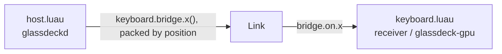

# glassdeck-luau

The Luau core both script hosts share: glassdeckd runs host halves on the host, and glassdeck-receiver and glassdeck-gpu run keyboard halves on the keyboard. Used on both sides.



## API

| Item | Role |
|---|---|
| `Vm` | One instance's VM: `new`, `seal` (read-only globals), `load`, `call`, `run_due_timers`, `next_timer`, `used_memory` |
| `Vm::every_function` | The `every(seconds, fn)` timer, for each host to expose |
| `CALL_LIMIT` | Any call into a script must return within 100 ms, or it is stopped |
| `encode` / `decode` | Plain Luau data to and from MessagePack, so a table sent on the host arrives identical on the keyboard |
| `color` | `color.hex`, `color.rgb`, `color.hsv` |
| `options` | `options.luau`: `OptionsScript` (`first_pass`, `run`), `Panel`, `Item`, `OptionItem`, `Kind`, `OptionValue`, `Values`, `Resolved` |
| `Panel::definitions` | Generates the `options.d.luau` that types `current` and `on_options` for the checker |
| `placement` | Where widgets sit: `WidgetArea`, `Placement`, `PlacedWidget`, `GRID`, and `check_widgets` for the rules a layout must keep. An instance's number is its place in the list, on both sides |
| Resource handles | `keyboard.resource(name)`, `host.resource(name)` and `live.resource(name)` return an opaque handle: `ResourceRef`, `LiveName`, `resource_of`, `MAX_LIVE_RESOURCE_BYTES` |

`types/` holds the Luau type definitions for the script APIs (`common`, `host`, `keyboard`, `canvas`, `options-api`). glassdeck-luau-check includes them.

## Used by

glassdeckd, glassdeck, glassdeck-slang, glassdeck-gpu, glassdeck-receiver.

## Platform

Portable. `mlua` builds Luau from source, so no native libraries are needed.

## Test

```sh
cargo test -p glassdeck-luau
```

Covers the MessagePack round trip, the hang guard, timers, sealing, options, placement and resource handles. No ignored tests.
