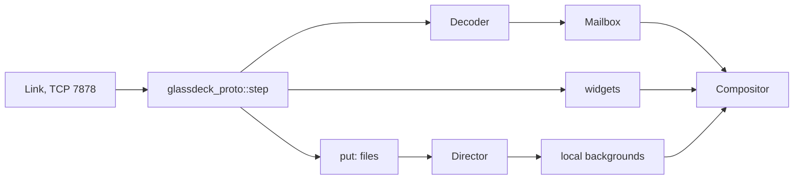

# glassdeck-receiver

The keyboard's Link server: the Decoder and Compositor stages, the widget host, and the local background player. A binary. On Linux it is the keyboard program; on Windows it builds as a preview window that stands in for the keyboard.



## What it does

- Accepts one host at a time on `--listen` and runs each message through glassdeck-proto's session table.
- Decodes `Live` frames on arrival (dropping stale ones) and `Paced` frames at their time (`playout`, `PACED_PLAYOUT_DELAY_US` behind).
- `screen`: which source owns the screen. A host stream first, then the chosen local background, then the built-in canvas. `Screen`, `Event` and `Effect` form one table, and `director::Director` carries out the effects.
- `local`: backgrounds played with no host. Video through its own decoder (`mp4` parses the MP4), web through glassdeck-local-web, canvases through glassdeck-gpu.
- `put`: installs the `.deck` packages the host sends through `<name>.tmp` and a rename. An upload must open as the package its file name says before it replaces anything.
- `widgets`: runs each placed widget's `keyboard.luau` in its own glassdeck-luau VM and draws its tiles into the key layer. Takes the layout from `SetWidgets` and picks up package changes while running. On each connect the receiver tells the host what it holds (`Inventory`), and deletes what `RemovePackages` names.
- `overlay` and `keymap`: key labels from the keymap's base layer, in Noto Sans JP Bold (`fonts/`, OFL).

## Platforms

| | Linux (keyboard) | Windows (preview) |
|---|---|---|
| Decoder | Rockchip MPP (`linux/mpp.rs`, `mpp_shim.c`), pictures stay in DMA buffers | Media Foundation (`windows/decode.rs`) |
| Compositor | DRM/KMS atomic commits: video plane (NV12) under the key layer on the primary plane | `minifb` window, blended on the CPU |
| Renderers | Separate processes over the compositor socket (`linux/renderer.rs`) | Canvases drawn in-process with glassdeck-gpu's library. Web backgrounds are not drawn (the host renders them with CEF instead) |
| Default listen | `0.0.0.0:7878` | `127.0.0.1:7878` |
| Data folder | `/var/lib/glassdeck/` | `C:\ProgramData\Glassdeck\` |

The Linux build needs Rockchip MPP through `pkg-config` (`rockchip_mpp`). Build for the keyboard with:

```sh
sh device/keyboard-build.sh glassdeck-receiver
```

## Options

`--listen`, `--font`, `--no-labels`, `--layout ansi|iso`, `--packages`, `--state`.

- `--packages` (default `/var/lib/glassdeck/packages/`): every installed `.deck`, backgrounds and widgets.
- `--state` (default `/var/lib/glassdeck/state/`): `background` (the chosen background) and `widgets.json` (the layout). Written only when they change, and restored at boot.

## Running on a board

On the Orange Pi stand-in (receiver built in `/opt/glassdeck/local`) it runs as the systemd service [`glassdeck-receiver`](../../device/systemd/glassdeck-receiver.service). The service starts at boot and restarts 2 s after any exit. Install it with `sh device/install-receiver-service.sh root@10.0.0.186`.

- Restart: `systemctl restart glassdeck-receiver`
- Stop: `systemctl stop glassdeck-receiver`
- Logs: `journalctl -u glassdeck-receiver -f`

The real keyboard's stock system still needs its own way to start it.

## Depends on, used by

glassdeck-proto, glassdeck-package, glassdeck-layout, glassdeck-luau, and glassdeck-gpu on Windows. No crate depends on it.

## Test

```sh
cargo test -p glassdeck-receiver
```

Tests in `linux/` (compositor, MPP, scanout) only run on Linux. No ignored tests.
