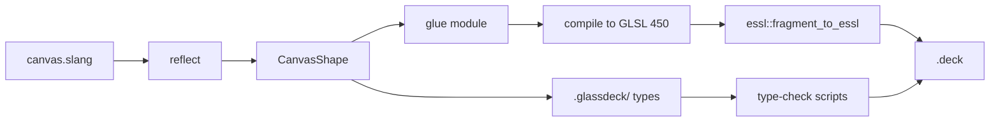

# glassdeck-slang

Slang's compilation API, and `glassdeck pack` for canvases. Host only: canvases are compiled when packing, so the keyboard never runs Slang.

It loads `glassdeck_slang` at run time with `libloading`. That library is the C++ wrapper in [`native/glassdeck-slang-native`](../../native).

## Packing a canvas

A canvas folder holds `deck.json`, `canvas.slang` and optionally `keyboard.luau`, `options.luau` and `host.luau`. `pack::pack_canvas(slang, luau, folder, out)` turns it into a background `.deck`:



1. Reflect the shader (with `slang/glassdeck.slang`, the glassdeck Slang API) into a `CanvasShape`: the `[Canvas]` function, its `[Inputs]` struct, scale and frame rate.
2. Write `.glassdeck/` beside the sources: the API definitions plus generated `inputs.d.luau` and `options.d.luau`, for editors and the checks.
3. Type-check each script with glassdeck-luau-check.
4. Generate a glue module (entry point `gd_fragment`, inputs uniform `gd_inputs`), compile to GLSL, and rewrite it as GLSL ES 3.00 for the keyboard's GLES 3 driver.
5. Write the manifest with the canvas's `details`, `shader.essl` and the scripts (see glassdeck-package).

`pack::check_widget(luau, folder)` does steps 2 and 3 for a widget's `options.luau` and `host.luau`.

## API

| Item | Role |
|---|---|
| `Slang::load(dir)` | Loads the wrapper from `dir` |
| `Slang::reflect(sources)` | `Declaration`s carrying user attributes |
| `Slang::compile(sources, entry, target, profile)` | Code for `Target::Spirv` or `Target::Glsl` |
| `Slang::has_profile(name)` | Whether Slang knows a profile |
| `Source { name, path, text }` | A module as text; later modules may import earlier ones |
| `ShaderError`, `Status` | Slang's diagnostics; `Status` mirrors `GdStatus` in `glassdeck_slang.h` |
| `canvas::CanvasShape` | Canvas shape from reflection, glue and input definitions |
| `essl::fragment_to_essl` | GLSL 450 to GLSL ES 3.00, fragment shaders only |
| `pack::{pack_canvas, check_widget, is_canvas_folder}` | The pack steps |

## Used by

glassdeck (the CLI's `pack`).

## Platform

Needs `glassdeck_slang` and Slang's own libraries, built by `native/build.py` into `target/native`.

## Test

```sh
cargo test -p glassdeck-slang
```

Tests cover `canvas` and `essl` and need no native library. No ignored tests.
