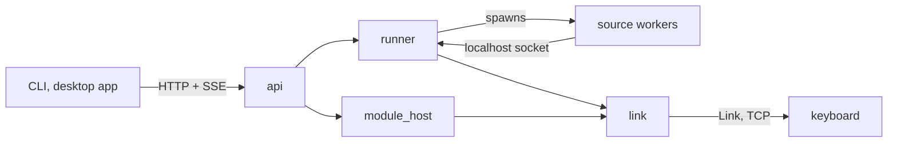

# glassdeckd

The host daemon, and the one program that talks to the keyboard. It owns the Link, runs sources in worker processes, runs the host sides of the active theme's background and widgets, and serves the local HTTP API that the CLI and the desktop app use. Windows only.



## Modules

| Module | What it does |
|---|---|
| `link` | The Link to the keyboard: a reconnecting state machine (`step`), plus `Uplink`, which queues streams, uploads, widget data, the background choice and the widget layout |
| `runner` | Runs at most one source at a time, each in a worker process (`step` is the state table). `StatusBoard` holds its status for waiters and publishes every change |
| `worker` | The worker side, run as `glassdeckd source`, because CEF can start only once per process |
| `module_host` | Runs the host side of the theme's background and of each widget through [glassdeck-host](../glassdeck-host). Restarts only what changed |
| `theme` | The active theme: checked against the installed packages, kept in `theme.json`, and turned into the keyboard's widget layout |
| `api` | The axum server. Its routes and types live in [glassdeck-api](../glassdeck-api) |
| `error` | Maps failures to API error codes. A failure is marked where it happens (`bad_request`, `conflict`); unmarked ones are internal |
| `streams` | `StreamName` and the built-in monitor streams a theme can show |
| `config` | `Paths` and `config.json` |
| `system` | One instance per user, logging to a file, and starting at login |

## Files

| Path | What |
|---|---|
| `%APPDATA%\Glassdeck\config.json` | The keyboard's address and the Link's rate |
| `%APPDATA%\Glassdeck\theme.json` | The active theme, as the app last pushed it |
| `%LOCALAPPDATA%\Glassdeck\active\` | Copies of the active theme's packages only, with their keyboard copies in `keyboard\` and digests in `active.json`. The app keeps the library |
| `%LOCALAPPDATA%\Glassdeck\api.json` | The API's port and token |

## Run

```sh
glassdeckd run [--keyboard 10.0.0.186:7878] [--log]
glassdeckd install     # start at login
glassdeckd uninstall
```

## Test

```sh
cargo test -p glassdeckd
```

The tests walk the Link and runner state tables and cover theme checks, what a new theme restarts, stream names and error codes.
