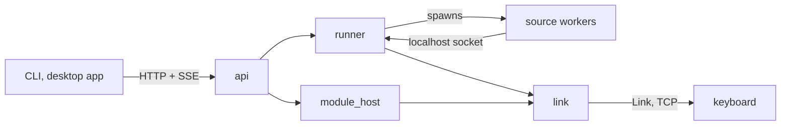

# glassdeckd

The host daemon, and the one program that talks to the keyboard. It owns the Link, runs sources in worker processes, runs the host halves of modules and canvases, and serves the local HTTP API that the CLI and the desktop app use. Windows only.



## Modules

| Module | What it does |
|---|---|
| `link` | The Link to the keyboard: a reconnecting state machine (`step`), plus `Uplink`, which queues streams, uploads, module data and the background choice |
| `runner` | Runs at most one source at a time, each in a worker process (`step` is the state table). `StatusBoard` holds its status for waiters and publishes every change |
| `worker` | The worker side, run as `glassdeckd source`, because CEF can start only once per process |
| `module_host` | Runs each widget's host side and the selected canvas's: options, plus `host.luau` or an implicit forwarder |
| `host_api` | The host-only Luau APIs: `live`, `image` and `media` |
| `options` | `OptionsStore` (`options.json`) for canvas options, and the panel views the API sends |
| `api` | The axum server. Its routes and types live in [glassdeck-api](../glassdeck-api) |
| `error` | Maps failures to API error codes. A failure is marked where it happens (`not_found`, `bad_request`, `conflict`); unmarked ones are internal |
| `streams` | `Choice` (what `bg` picks) and the built-in monitor streams |
| `deploy` | Puts files on the keyboard, and keeps local copies of modules, the profile, and canvases that run on the host |
| `config` | `Paths` and `config.json` |
| `system` | One instance per user, logging to a file, and starting at login |

## Files

| Path | What |
|---|---|
| `%APPDATA%\Glassdeck\config.json` | The keyboard's address and the Link's rate |
| `%APPDATA%\Glassdeck\profile.json` | The widgets in place, with their options |
| `%APPDATA%\Glassdeck\options.json` | Canvas options, by background |
| `%APPDATA%\Glassdeck\bg.json` | The remembered background choice |
| `%APPDATA%\Glassdeck\modules\` | Installed modules |
| `%LOCALAPPDATA%\Glassdeck\api.json` | The API's port and token |
| `%LOCALAPPDATA%\Glassdeck\canvases\` | Copies of canvases that have options or a host half |

## Run

```sh
glassdeckd run [--keyboard 10.0.0.186:7878] [--log]
glassdeckd install     # start at login
glassdeckd uninstall
```

## Test

```sh
cargo test -p glassdeckd
```

The tests walk the Link and runner state tables and cover options storage, deploy targets and error codes.
